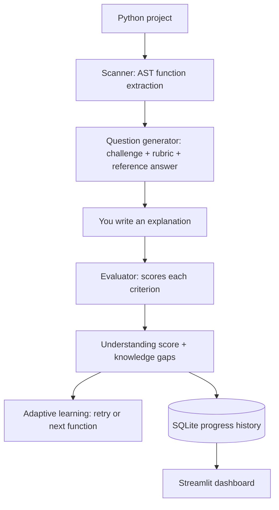

# 🧠 LegitX — Know Your Code. Own Your Skills.

> Passing tests proves your code works. LegitX checks whether **you** understand why.

LegitX is an AI-powered learning tool that scans your Python project, quizzes you on your own functions, and scores your explanations so you can find and close gaps in your understanding. It's especially useful if you lean on AI assistants or copy-pasted snippets and want to be sure you could still explain, debug, and defend what's in your repo.

<!-- Add a screenshot or GIF of the dashboard here, e.g.:

-->

---

## Table of Contents

- [Features](#-features)
- [Quick Start](#-quick-start)
- [Usage](#-usage)
- [How It Works](#-how-it-works)
- [Understanding Scores](#-understanding-scores)
- [Privacy and Security](#-privacy-and-security)
- [Project Structure](#-project-structure)
- [Tech Stack](#-tech-stack)
- [Troubleshooting](#-troubleshooting)
- [Roadmap](#-roadmap)
- [Contributing](#-contributing)

---

## ✨ Features

| | Feature | What it does |
|---|---|---|
| 🔍 | **Codebase scanning** | Walks your project and extracts every function with Python's `ast` module |
| ❓ | **Function-specific questions** | Generates challenges from your actual code, not generic trivia |
| 📝 | **Rubric-based evaluation** | Scores your explanation against criteria generated for that function |
| 🎯 | **Knowledge-gap detection** | Highlights concepts and implementation details you missed |
| 🔁 | **Adaptive retries** | Suggests follow-up practice based on how you did |
| 📈 | **Progress tracking** | Stores every attempt in SQLite and tracks performance per function |
| 🖥️ | **Two interfaces** | Streamlit dashboard or a terminal workflow |

---

## 🚀 Quick Start

**Prerequisites:** Python 3.9+ and a free [Groq API key](https://console.groq.com/keys).

```bash
# 1. Clone and enter the project
git clone https://github.com/triumph10/LegitX---Know-Your-Code.git
cd LegitX---Know-Your-Code

# 2. Create and activate a virtual environment
python -m venv venv
source venv/bin/activate        # macOS / Linux
venv\Scripts\activate           # Windows

# 3. Install dependencies
pip install -r requirements.txt

# 4. Add your API key
cp .env.example .env            # then edit .env  (Windows: copy .env.example .env)

# 5. Launch
streamlit run dashboard.py
```

Your `.env` should look like this:

```env
GROQ_API_KEY=your_groq_api_key
GROQ_MODEL=openai/gpt-oss-120b
```

| Variable | Required | Description |
|---|---|---|
| `GROQ_API_KEY` | ✅ | Your Groq API key |
| `GROQ_MODEL` | ❌ | Model used for question generation and evaluation (default shown above) |

---

## 🕹️ Usage

### Dashboard (recommended)

```bash
streamlit run dashboard.py
```

1. Enter the path to a Python project folder and click **Scan**.
2. Pick a function to practise.
3. Read the generated challenge and write your explanation.
4. Review your score, per-criterion feedback, and knowledge gaps.
5. Retry, or move on to the function LegitX recommends next.
6. Open the history view to see your progress over time.

### Terminal

```bash
python main.py
```

Enter your project path when prompted and follow the on-screen steps.

---

## 🧩 How It Works



---

## 📊 Understanding Scores

Each evaluation returns:

- Per-criterion scores with feedback and supporting evidence
- Strengths and knowledge gaps
- Overall feedback and a suggested model answer

Scores are **learning indicators**, not objective measures of your ability or mastery of a codebase. They come from an LLM, so treat them as a useful second opinion rather than a verdict.

---

## 🔒 Privacy and Security

- **Your code leaves your machine.** Function source code and your answers are sent to the Groq API for question generation and evaluation. Don't scan proprietary or sensitive code unless that's acceptable under your own policies.
- **Keep your API key private.** Make sure `.env` is in `.gitignore` and never commit it. If a key is ever exposed, revoke it in the Groq console and create a new one.
- **Progress data stays local** in `data/legitx.db`.

---

## 📂 Project Structure

```text
LegitX/
├── main.py                # Terminal workflow
├── dashboard.py           # Streamlit interface
├── scanner.py             # AST scanning and function extraction
├── question_generator.py  # Challenges, rubrics, and reference answers
├── evaluator.py           # Scores user explanations
├── adaptive_learning.py   # Retry logic and next-step recommendations
├── progress_tracker.py    # Per-function progress tracking
├── database.py            # SQLite storage and retrieval
├── requirements.txt
├── .env.example           # Template for your .env
└── data/
    └── legitx.db          # Created automatically on first run
```

---

## 🛠️ Tech Stack

| Technology | Purpose |
|---|---|
| Python + `ast` | Core app and function extraction |
| [Groq API](https://groq.com) | Question generation and evaluation |
| Streamlit | Web dashboard |
| SQLite | Local evaluation history |
| python-dotenv | Environment variable loading |

---

## 🩹 Troubleshooting

| Problem | Fix |
|---|---|
| `GROQ_API_KEY` not found | Confirm `.env` is in the project root and you launched the app from that folder |
| `ModuleNotFoundError` | Activate your virtual environment and re-run `pip install -r requirements.txt` |
| No functions found | Check the path points to a folder containing `.py` files |
| Model or rate-limit errors | Try a different `GROQ_MODEL` or wait a moment and retry |

---


**LegitX — Don't just write code. Understand it.**